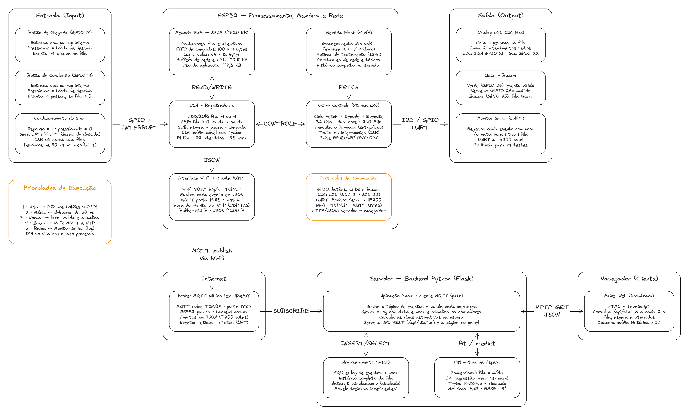

# Citizen Assist AI — Sistema Inteligente de Gerenciamento de Filas Virtuais

Global Solution 2026.2 · FIAP · Turma 1CC-FEV · Arquitetura e Organização de Computadores

Protótipo que registra a **chegada** e a **conclusão** de atendimentos com botões (ESP32 simulado no Wokwi),
valida as operações, acompanha o tamanho da fila, **estima o tempo de espera** (média histórica × regressão linear)
e mostra tudo num **painel no navegador**, em tempo real, pela internet (MQTT).

> **Atenção: os dados de treino da previsão são SIMULADOS** (sintéticos, gerados por `backend/previsao/simulador.py`).
> Todo arquivo de dados traz `origem = SIMULADO`, e o painel avisa. Os resultados de previsão não são medições
> de um atendimento real.

## Integrantes e links

| | |
|---|---|
| Integrantes: | 
Sergio Augusto | RM 570184 **(Representante)**
Gabriel Freitas | RM: 572943
Giovanni Merlotti | RM: 573721 |
| Projeto no Wokwi | https://wokwi.com/projects/480890007286427649 |
| Vídeo de demonstração (até 5 min) | https://youtu.be/Ej9Zt5xLL28?si=GRlG4IAIbUUc4fkM |
| Relatório técnico | `docs/` e no `.txt` da entrega |

## Arquitetura



O arquivo editável está em `docs/diagrama_arquitetura.excalidraw` (abra em [excalidraw.com](https://excalidraw.com)).
O PNG é uma pré-visualização do diagrama.

**Fluxo de um evento**

1. O botão (GPIO 18 = chegada, GPIO 19 = conclusão) gera uma **interrupção**; a ISR só incrementa um contador.
2. O laço principal aplica o **debounce** (50 ms), valida (a fila nunca fica negativa), atualiza a FIFO e o log,
   e calcula os tempos de espera e de atendimento.
3. O ESP32 mostra o resultado no **LCD**, nos **LEDs**, no **buzzer** (operação inválida) e no **Monitor Serial**.
4. Publica o evento em **JSON por MQTT** (Wi-Fi) em um broker público. A hora vem do **NTP**.
5. O **backend Flask** assina o tópico, valida a mensagem, grava no **SQLite** e calcula as duas estimativas de espera.
6. O **painel** consulta `/api/status` a cada 2 s e exibe fila, espera estimada, atendimentos concluídos e a comparação.

**Decisões de projeto**

- O **ESP32 é a fonte da verdade** da fila (valida, conta e registra, mesmo sem rede); o backend espelha o estado.
- A **previsão roda no backend**. O firmware só reporta os fatos (fila, tempos, média de atendimento).
- A comunicação usa **MQTT** por um broker público, para o ESP32 simulado no Wokwi alcançar o backend sem túnel.
- O modelo é treinado com **dados simulados identificados** e o resultado é apresentado como ele é (ver "Previsão de espera").

## Estrutura do repositório

```
.
├── firmware/                  ESP32: código, circuito do Wokwi e testes
│   ├── sketch.ino             programa principal (interrupções, LCD, LEDs, buzzer, Serial, NTP, MQTT, diagnóstico)
│   ├── fila_core.h            núcleo da fila (sem hardware): FIFO, validação, log, média móvel, debounce
│   ├── diagram.json           circuito do Wokwi
│   ├── libraries.txt          bibliotecas do Wokwi (LiquidCrystal I2C, PubSubClient)
│   └── test/                  testes no computador (g++), com stubs do Arduino
├── backend/                   servidor e painel
│   ├── app.py                 Flask: painel + API JSON + assinatura MQTT
│   ├── servico.py             validação das mensagens, estado e estimativas
│   ├── banco.py               SQLite (histórico de eventos)
│   ├── mqtt_cliente.py        cliente MQTT (paho-mqtt)
│   ├── static/                painel (HTML, CSS, JavaScript)
│   ├── previsao/              Etapa 3: simulador, treino, comparação e modelo
│   ├── ferramentas/           simulador do ESP32 e exportação de dados reais
│   └── tests/                 testes do backend, de ponta a ponta e do painel
├── analise/                   scripts das medições da Etapa 5 (presentes no relatório)
├── docs/                      diagrama de arquitetura e o relatório técnico em PDF
└── README.md                  este arquivo
```

Cada pasta principal tem seu próprio README com detalhes: [`firmware/`](firmware/README.md),
[`backend/`](backend/README.md) e [`backend/previsao/`](backend/previsao/README.md).

## Pré-requisitos

| Para | Precisa de |
|---|---|
| Rodar o backend e o painel | **Python 3.11 ou superior** (testado com 3.12) e um navegador |
| Rodar o firmware | uma conta gratuita no [Wokwi](https://wokwi.com) (roda no navegador) |
| Refazer a simulação e o treino (Etapa 3) | as bibliotecas de `backend/previsao/requirements.txt` |
| Rodar os testes do firmware | `g++` (opcional) |
| Teste de ponta a ponta e do painel | `amqtt` e Node.js com `jsdom` (opcionais) |

## Como executar

### 1. Backend e painel

Em um terminal, dentro da pasta `backend`:

```bash
python -m venv .venv
.venv\Scripts\activate             # Linux/macOS: source .venv/bin/activate
python -m pip install -r requirements.txt
python app.py
```

Abra **http://127.0.0.1:5000**. Para parar, `Ctrl+C`. (Se o PowerShell bloquear o `activate`, use o CMD.)

### 2. Tópico MQTT único (importante)

O broker é **público e sem senha**, portanto, o nome do tópico **PRECISA** ser o mesmo no **firmware**
e no **backend** para que o projeto funcione. Definimos o nome como `gs2026-Stig4` em `sketch.ino` e `backend/config.py`.


### 3. Firmware no Wokwi

1. Em [wokwi.com](https://wokwi.com), crie um projeto **ESP32** (Arduino).
2. Cole o conteúdo de `firmware/sketch.ino`, `firmware/diagram.json` e `firmware/libraries.txt` nas abas de mesmo nome.
3. Crie um arquivo novo chamado `fila_core.h` (botão **+**) e cole o conteúdo de `firmware/fila_core.h`.
4. Clique em **Start** e abra o Monitor Serial. Aguarde `Hora sincronizada via NTP` e `MQTT conectado ao broker`.
5. Use os botões (ou as teclas **c** = chegada e **s** = conclusão, com o circuito em foco) e acompanhe o painel.

### Sem o Wokwi (Solução Alternativa)

Com o backend rodando, em outro terminal (dentro de `backend`, com o mesmo ambiente virtual ativo):

```bash
python ferramentas/simulador_esp32.py
```

Ele publica eventos no mesmo formato do firmware (**não é o firmware**; serve só para testar o backend e o painel).

## Testes mínimos do enunciado

| # | Situação | Como fazer | Onde ver |
|---|---|---|---|
| 1 | Chegada de novos cidadãos | Pressione **Chegada** 3 vezes | LCD `Fila: 3`; linhas `CHEGADA` no Serial; LED verde; painel com 3 na fila |
| 2 | Conclusão de atendimentos | Pressione **Conclusão** 2 vezes | LCD `Fila: 1` e `Atendidos: 2`; linhas `CONCLUSAO` com espera e atendimento; painel atualizado |
| 3 | Saída com a fila vazia | Esvazie a fila e pressione **Conclusão** | LED vermelho, dois bipes, `Fila vazia!` no LCD, `REJEITADA (fila vazia)` no Serial; fila continua 0; "Operações recusadas" sobe no painel |
| 4 | Atualização da estimativa de espera | Aumente e diminua a fila | O **tempo estimado** do painel (IA e convencional) muda a cada evento; sem média de atendimento ainda, o painel avisa que a IA usa o método convencional |

## Onde está cada etapa do enunciado

| Etapa | O que foi entregue | Onde |
|---|---|---|
| 1. Arquitetura | diagrama com CPU, memória, entradas, saídas e rede, e explicação do fluxo | `docs/diagrama_arquitetura.*` e a seção "Arquitetura" |
| 2. Fila virtual | botões, contagem, validação, log com horário, LCD/LEDs/buzzer | `firmware/` |
| 3. Previsão inteligente | dados simulados, estimativa convencional × regressão linear, métricas | `backend/previsao/` |
| 4. Comunicação e visualização | MQTT, backend, SQLite e painel no navegador | `backend/` e `firmware/sketch.ino` |
| 5. Análise da arquitetura | processador, memória, E/S, protocolos, limitações, medições | relatório em `docs/`, `analise/` e as linhas `[DIAG]` do firmware |

## Previsão de espera

Comparação no conjunto de **teste** (os 12 últimos dias; os 28 primeiros treinam), só com fila ≥ 1, em **dados simulados**:

| Método | MAE | RMSE | R² | Viés | Acertos ≤ 2 min |
|---|---|---|---|---|---|
| Convencional (pessoas × média histórica) | 2,93 min | **3,96 min** | **0,799** | +0,70 min | 41,5% |
| **IA: regressão linear** | **2,70 min** | 4,02 min | 0,793 | **+0,09 min** | **55,0%** |

A IA erra menos **na média** e elimina o viés, mas **empata em RMSE e R²**. Os números dependem das hipóteses do simulador;
com dados reais podem mudar. Detalhes e gráfico em [`backend/previsao/`](backend/previsao/README.md).

Para retreinar com dados reais: `python backend/ferramentas/exportar_dataset.py` e depois, em `backend/previsao`,
`python treinar.py --csv dados/dados_reais.csv`.

## Testes automatizados

| Conjunto | Comando | O que cobre |
|---|---|---|
| Firmware (núcleo e sketch simulado) | `bash firmware/test/run_tests.sh` | fila, validação, log, debounce com bounce, LCD, LEDs, buzzer, MQTT, diagnóstico |
| Previsão (Etapa 3) | `cd backend/previsao && python -m unittest discover -s tests` | dataset, simulador, estimador, treino e divisão cronológica |
| Backend | `cd backend && python -m unittest discover -s tests` | validação das mensagens, estado, API e **contrato com o firmware** |
| Ponta a ponta (opcional) | `pip install amqtt`, depois o mesmo comando do backend | broker MQTT real local, mensagens retidas e *last will* |
| Painel (opcional) | `cd backend/tests && npm install jsdom`, depois `cd .. && node tests/painel.test.js` | lógica do painel num navegador simulado |

A simulação do sketch no computador valida a lógica (botões com bounce, LCD, LEDs, buzzer, Serial e MQTT), mas **não
equivale/substitui** a execução no Wokwi na prática.

## Medições e análise (Etapa 5)

- `analise/medir_memoria.cpp`: tamanho real (`sizeof`) das estruturas do firmware.
- `analise/medir_rede_e_backend.py`: tamanho das mensagens, volume do painel e desempenho do backend (neste computador).
- O firmware imprime linhas `[DIAG]` no Serial (heap, pilha, tempo do laço, LCD e publicação MQTT). No Wokwi: heap total
  de 311,7 KB com no mínimo 205,6 KB livres, pilha com 30% de uso máximo, LCD ≈ 101 ms e publicação MQTT ≈ 3 ms.
  Os tempos de CPU do simulador **não equivalem** aos do chip real.

## Limitações conhecidas

- Os dados de treino são **simulados**; um único atendente e atendimento em ordem de chegada.
- O broker público **não tem autenticação nem criptografia**; a proteção é o tópico único e a validação no backend.
- A biblioteca PubSubClient publica só com **QoS 0** (uma mensagem pode se perder; o `seq` mostra a lacuna).
- Alguns trechos do firmware **bloqueiam o laço** (bipes de ≈ 0,28 s; tentativa de conexão ao broker).
- O log e a fila do ESP32 ficam **só na RAM**; o histórico completo está no servidor.
- O painel usa *polling* (≈ 7,3 MB por hora por navegador aberto) e o Flask embutido é para demonstração.

## Tecnologias

ESP32 (Arduino-ESP32) · Wokwi · MQTT (PubSubClient e paho-mqtt) · NTP · Python (Flask, SQLite) · scikit-learn
(só no treino) · HTML, CSS e JavaScript simples · Excalidraw.

